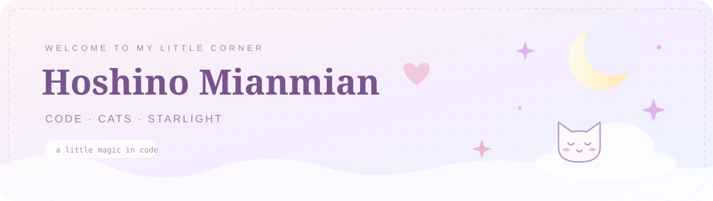

# 你好呀，我是星野眠眠 ₍ᐢ. .ᐢ₎ 🌙

**在代码和星光之间，做一点有用、也有一点可爱的小东西。**

`wwjwisdom` · 欢迎来到我的代码小窝

 

<table>
<tr>
<td width="64%" valign="middle">

### 🐾 小窝里的开发日常

从 C++ 的内存与进程，到 Python 的实用小工具，再到 STM32 的传感器世界，把一个个想法慢慢做成能用的作品。

喜欢让工具少一点麻烦，让问题多一点线索。

这里收着我的代码、实验和一些刚刚长出猫耳朵的小项目。欢迎随便逛逛，也欢迎在项目里留下建议 ✨

</td>
<td width="36%" align="center">

星野眠眠 · Hoshino Mianmian

</td>
</tr>
</table>

### 🎀 放在小窝门口的作品

| 小作品 | 它在做什么 | 去看看 |
| :--- | :--- | :--- |
| 🐈 **Process Memory Lite** | 给进程内存一个小看板：实时曲线、句柄/线程统计、定时 TXT 记录。 | [项目介绍](https://github.com/wwjwisdom/process-memory-lite) · [下载](https://github.com/wwjwisdom/process-memory-lite/releases/latest) |
| 🧹 **Safe Junk Cleaner** | 面向 Windows、macOS 和 Linux 的安全垃圾清理工具。 | [打开工具箱](https://github.com/wwjwisdom/safe-junk-cleaner) |
| 🌱 **STM32 环境监测平台** | 多传感器与环境监测相关的开发实践。 | [打开实验室](https://github.com/wwjwisdom/Multi-Sensor-Intelligent-Environmental-Monitoring-Platform-Based-on-STM32) |

📚 再翻一页，还有这些代码收藏

- [负载均衡在线 OJ 项目](https://github.com/wwjwisdom/load-balacing-online-oj-project)
- [PCRE2 Search Engine](https://github.com/wwjwisdom/PCRE2_Search_Engine)
- [面向 AI Agent 的清理技能](https://github.com/wwjwisdom/safe-junk-cleaner-skill)

### ☁️ 留一颗星星再走吧

如果某个小工具恰好帮到了你，欢迎给它一颗 Star。 
遇到问题或有新点子，也可以去对应项目的 Issues 留言。

愿每一个难解的 Bug，最后都变成一颗小星星。 ✧

